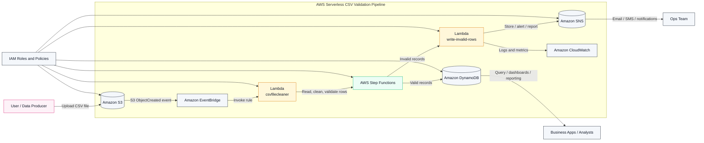

# AWS Serverless CSV Validation Pipeline Architecture

This diagram shows the proposed serverless flow for ingesting, validating, cleaning, and routing CSV records in AWS.



## Flow Description

1. A CSV file is uploaded to an Amazon S3 bucket.
2. EventBridge listens for the S3 `ObjectCreated` event.
3. The `csvfilecleaner` Lambda is triggered to inspect the file, parse row data, and perform validation and cleaning.
4. The Step Functions workflow decides whether each row or file is valid or invalid.
5. Valid records are stored in DynamoDB.
6. Invalid records are handled by the `write-invalid-rows` Lambda.
7. The invalid-row handler can log issues, push alerts, or send notifications using SNS and CloudWatch.

## Security and Operations

- IAM roles grant least-privilege access to S3, Lambda, Step Functions, DynamoDB, and SNS.
- CloudWatch provides monitoring, logging, and alerting for pipeline execution.
- SNS can be used to notify teams about rejected records or operational issues.

## Optional Export to PNG

To render this Mermaid diagram as a PNG image for slides or documentation:

```bash
npx -y @mermaid-js/mermaid-cli -i architecture.mmd -o architecture.png -b transparent -w 2200 -H 1400
```

This keeps the AWS service styling while producing a cleaner presentation-ready image.
