# AWS Serverless CSV Validation Pipeline Architecture

This diagram shows the proposed serverless flow for ingesting, validating, cleaning, and routing CSV records in AWS.

```mermaid
flowchart LR
    Start((Start))
    Start --> ProcessCSV["Map: CSV file<br/>Process CSV"]
    ProcessCSV --> ValidateRow["AWS Lambda: Invoke<br/>Validate Row"]
    ValidateRow --> CheckValidity{"Choice state<br/>Check Validity"}

    CheckValidity -- "$.status == \"VALID\"" --> WriteToDynamoDB["Amazon DynamoDB: PutItem<br/>Write To DynamoDB"]
    CheckValidity -- "Default" --> ReturnInvalidRow["Pass state<br/>Return Invalid Row"]

    WriteToDynamoDB --> ReturnValidRow["Pass state<br/>Return Valid Row"]
    ReturnValidRow --> Merge(( ))
    ReturnInvalidRow --> Merge

    Merge --> ExportLocation["Export location: csvfilebucketname"]
    ExportLocation --> WriteInvalidRows["AWS Lambda: Invoke<br/>Write Invalid Rows To S3"]
    WriteInvalidRows --> PublishSummary["Amazon SNS: Publish<br/>Publish Summary To SNS"]
    PublishSummary --> End((End))

    classDef startEnd fill:#f5f5f5,stroke:#1f2937,stroke-width:1px,color:#111827;
    classDef lambda fill:#fff7da,stroke:#d97706,stroke-width:1px,color:#111827;
    classDef db fill:#ebf2ff,stroke:#2563eb,stroke-width:1px,color:#111827;
    classDef sns fill:#fdf2f8,stroke:#be185d,stroke-width:1px,color:#111827;
    classDef pass fill:#edf7ff,stroke:#4b5563,stroke-width:1px,color:#111827;
    classDef choice fill:#f0fdf4,stroke:#16a34a,stroke-width:1px,color:#111827;

    class Start,End startEnd;
    class ValidateRow,WriteInvalidRows lambda;
    class WriteToDynamoDB db;
    class PublishSummary sns;
    class ProcessCSV,ReturnValidRow,ReturnInvalidRow,ExportLocation pass;
    class CheckValidity choice;
```

## Flow Description

1. A CSV file enters the Step Functions workflow and is processed.
2. A Lambda task validates each row.
3. A choice state checks whether the row is valid.
4. Valid rows are written to DynamoDB.
5. Invalid rows are returned to the invalid-row handling path.
6. The workflow exports invalid rows to S3.
7. A final SNS notification publishes the summary and completes the workflow.

## Security and Operations

- IAM roles grant least-privilege access to S3, Lambda, Step Functions, DynamoDB, and SNS.
- CloudWatch provides monitoring, logging, and alerting for pipeline execution.
- SNS can be used to notify teams about rejected records or operational issues.

## Recommended Next Step

Use this state-machine view as the canonical workflow for the CSV validation pipeline, then translate it into infrastructure-as-code or a slide-ready architecture diagram.
